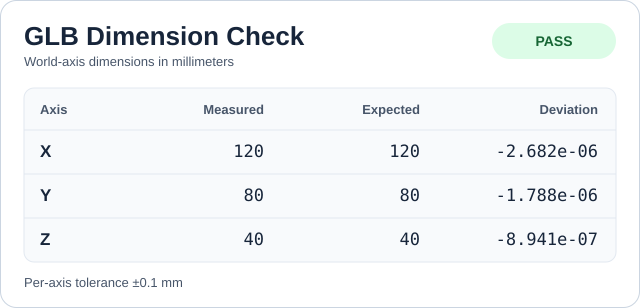
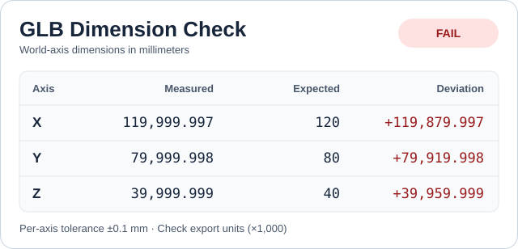

# GLB Dimension Check

Measure the real-world dimensions encoded in a static GLB. Compare the scene's
X, Y, and Z dimensions with your reference measurements to catch scale mistakes
before handing off a model for web 3D or AR.

静态 GLB 尺寸验收工具。读取场景的 X、Y、Z 轴尺寸，按毫米与预期尺寸比较。

## Quick start

Use Python 3.8 or newer. The script uses only the Python standard library.

```sh
python scripts/check_glb.py examples/correct.glb --expected-mm 120 80 40
```

Use `--expected-mm X Y Z` in scene-axis order. The check passes when all three
axes are within `--tolerance-mm`, which defaults to 0.1 mm. The JSON report
includes measured dimensions, expected dimensions, and signed deviations in
millimeters. Run the script with just the GLB path to measure only.

| Exit code | Meaning |
| --- | --- |
| 0 | `pass` or `measured` |
| 1 | `fail`. At least one axis exceeded the tolerance. |
| 2 | Unsupported input, invalid geometry or expectation file, command-line error, or SVG write error. |

## Check against a JSON expectation file

Copy [examples/expected.json](examples/expected.json) to save the expected
dimensions and tolerance for a model. The template checks the included
120 × 80 × 40 mm example.

```sh
python scripts/check_glb.py examples/correct.glb --expect examples/expected.json
python scripts/check_glb.py examples/1000x-too-large.glb --expect examples/expected.json --svg scale-error.svg
```

Save the file as UTF-8 JSON. Set `expected_mm.x`, `expected_mm.y`, and
`expected_mm.z` to the expected dimensions in the GLB scene's X, Y, and Z axes.
The optional `tolerance_mm` is a single tolerance for each axis and defaults
to 0.1 mm. All four values must be finite, nonnegative JSON numbers. The CLI
rejects unknown fields and reports invalid fields on stderr with exit code 2.

Use `--expect PATH` on its own or with `--svg PATH`. Passing `--expected-mm` or
`--tolerance-mm` alongside `--expect` is a command-line error. A dimension
mismatch still returns exit code 1 and writes the SVG when requested.

## Check your own GLB

1. Run `python scripts/check_glb.py model.glb` to see the exported X, Y, and Z
   dimensions in millimeters.
2. Map the dimensions from your drawing or CAD model to the exported GLB axes.
   Use those reference values in `--expected-mm X Y Z`.

The export can change the axis order. For example, the Hammond 1590B enclosure
we tested measured X/Y/Z = 112.4/31.0/60.5 mm in STEP and 112.4/60.5/31.0 mm
after export to a Y-up GLB. That export passed with
`--expected-mm 112.4 60.5 31.0` at the default 0.1 mm tolerance.
[Hammond 1590B drawing](https://www.hammfg.com/files/parts/pdf/1590B.pdf)

## Export an SVG dimension card

Add `--svg PATH` to save a shareable card alongside the JSON on stdout. The
card shows the measured, expected, and signed deviation values for X, Y, and Z,
plus the result. It uses the same report as the JSON and formats numbers for
display. Measurement-only cards show dashes for expected values and deviations.

Run the following commands separately. The second returns exit code 1 for
the intentional scale error and writes the FAIL card.

```sh
python scripts/check_glb.py examples/correct.glb --expected-mm 120 80 40 --svg examples/correct.svg
python scripts/check_glb.py examples/1000x-too-large.glb --expected-mm 120 80 40 --svg examples/1000x-too-large.svg
```

**Correct dimensions**



**1000× scale error**



## Diagnose a mismatch

A failed check includes a `diagnosis` object with `out_of_tolerance_axes` and
one of three types. The check always uses the original X/Y/Z order.

| Type | What to check |
| --- | --- |
| `unit_scale` | On all three axes, the measured-to-expected ratios are within 1% of 1000 or 0.001. Check meters versus millimeters. |
| `axis_permutation` | A different order of the expected dimensions fits within tolerance. `axis_mapping` maps each measured axis to a matching expected axis. Check the orientation and input order. |
| `axis_mismatch` | Review the listed axes and their signed deviations. A single-axis mismatch always uses this type. |

```sh
python scripts/check_glb.py examples/1000x-too-large.glb --expected-mm 120 80 40
python scripts/check_glb.py examples/correct.glb --expected-mm 80 120 40
python scripts/check_glb.py examples/correct.glb --expected-mm 110 80 40
```

## Three reproducible examples

```sh
python scripts/check_glb.py examples/correct.glb --expected-mm 120 80 40
python scripts/check_glb.py examples/1000x-too-large.glb --expected-mm 120 80 40
python scripts/check_glb.py examples/measure-only.glb
```

| Example | Expected result |
| --- | --- |
| [correct.glb](examples/correct.glb) | `pass`. Approximately 120 × 80 × 40 mm. |
| [1000x-too-large.glb](examples/1000x-too-large.glb) | `fail`. A parent scale of 1000 produces approximately 120,000 × 80,000 × 40,000 mm. |
| [measure-only.glb](examples/measure-only.glb) | `measured`. A rotated triangle produces approximately 141.421 × 70.711 × 40 mm. An unreferenced vertex in the position buffer does not affect the result. |

Regenerate the included GLB files with `python examples/generate.py`. Run the
CLI checks with `python -B -m unittest discover -s tests -v`.

## Supported inputs

The script accepts static GLB 2.0 files with a single embedded binary buffer and
standard float32 vertex positions. It reads the default scene, or the first
scene when the file has no default. It applies parent and child transforms,
including matrix and translation/rotation/scale transforms. It measures the
world-axis extent of the mesh vertices used by the scene. A rotated model's
measured envelope may differ from its drawing dimensions.

Static GLBs with the `KHR_materials_unlit` extension can be measured even when
the extension is declared as required. Animations, skinning, morph targets,
compressed or quantized geometry, and other required glTF extensions are
outside this version's scope. For separate `.gltf`, OBJ, FBX, STL, and STEP,
export a static GLB first and verify the export units.

## Use as an Agent Skill

Clone or copy this repository into a skill directory named
`glb-dimension-check`. An [Agent Skills](https://agentskills.io/specification)
client can load [SKILL.md](SKILL.md). Try asking it to check a GLB against
120 × 80 × 40 mm in X/Y/Z order.

The unit conversion follows the
[glTF 2.0 specification](https://registry.khronos.org/glTF/specs/2.0/glTF-2.0.html#coordinate-system-and-units).

## License

[MIT](LICENSE)
