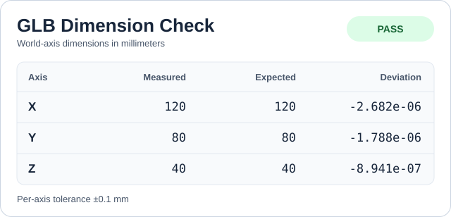
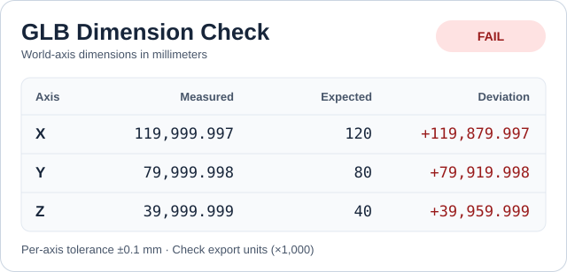

# GLB 尺寸验收

[](https://github.com/LeeJUNhao791/glb-dimension-check/actions/workflows/ci.yml)
[](https://github.com/LeeJUNhao791/glb-dimension-check/releases/latest)
[](LICENSE)

[English](README.md) · [在线试用](https://leejunhao791.github.io/glb-dimension-check/)

按毫米读取静态 GLB 的场景包围盒，并逐轴对照图纸或交付尺寸。可在 Web 3D 或 AR 交付前发现导出单位和轴顺序错误。

| 尺寸正确 · PASS | 1000 倍比例错误 · FAIL |
| --- | --- |
|  |  |

## 浏览器快速体验

1. 打开在线示例，点击 **Pass example** 和 **1000× scale error**。两个样例默认使用 `120 × 80 × 40 mm` 的参考尺寸和每轴 `0.1 mm` 的容差，结果分别为 PASS 和 FAIL。
2. 检查自己的模型时，拖入或选择一个 `.glb` 文件。可手动输入预期尺寸和容差，也可通过 **Import expected.json** 导入 [JSON 预期尺寸文件](examples/expected.json)。文件省略容差时使用每轴 `0.1 mm`。导入成功后仍可编辑，样例也会使用表单中的当前值。点击 **Check dimensions** 开始检查。
3. PASS 和 FAIL 均可下载。点击 **Download SVG** 保存验收卡，或点击 **Download JSON** 保存与命令行输出一致的检查报告。

网页使用 Pyodide 在浏览器内运行 Python 检查器。首次导入或检查会从 jsDelivr 加载运行时，你选择的文件留在浏览器中。纯离线检查可使用下面的命令行。

本地体验时，在仓库根目录运行以下命令，再打开 [本地页面](http://127.0.0.1:8000/)。本地网页的首次导入或检查同样需要连接 jsDelivr。

```sh
python -m http.server 8000 --bind 127.0.0.1
```

## 导入预期尺寸与导出报告

复制 [examples/expected.json](examples/expected.json)，按 GLB 的 X/Y/Z 轴顺序填写参考尺寸，保存为 UTF-8 JSON：

```json
{
  "expected_mm": { "x": 120, "y": 80, "z": 40 },
  "tolerance_mm": 0.1
}
```

`expected_mm` 的三个轴都必须存在。所有数值必须是有限、非负的 JSON 数字，不接受数字字符串或额外字段。`tolerance_mm` 可省略，默认每轴 `0.1 mm`。浏览器与 CLI 使用相同的文件校验规则。导入失败会显示原因并保留原有表单值；修正文件后可再次选择。

**Download JSON** 导出的是含 `status`、`dimensions_mm`、`expected_mm`、`deviation_mm` 和 `tolerance_mm` 的检查报告；失败时还包含 `diagnosis`。报告含有预期尺寸文件不接受的字段，不能直接作为 `expected.json` 重新导入。若要复用参考尺寸，只保留上面模板中的两个字段。

**Download SVG** 导出便于分享的验收卡。卡片对数值作显示格式化，判定使用未格式化的数值；接近容差边界时请查看 JSON 中的偏差和 `status`，不要根据卡片显示的小数位重新判定。float32 顶点和导出变换可能带来微小数值误差，应根据交付要求设置容差。


## 命令行与离线检查

在仓库根目录运行，使用 Python 3.8 或更新版本，无须安装第三方库。

```sh
python scripts/check_glb.py examples/correct.glb --expected-mm 120 80 40
python scripts/check_glb.py examples/1000x-too-large.glb --expect examples/expected.json --svg scale-error.svg
python scripts/check_glb.py examples/measure-only.glb
```

第一条命令通过并返回 `0`。第二条命令报告 1000 倍的尺寸错误并返回 `1`，同时生成 `scale-error.svg`。第三条命令只测量尺寸并返回 `0`。输入或写入错误返回 `2`。

`--expect` 可与 `--svg` 一起使用，但不能同时传入 `--expected-mm` 或 `--tolerance-mm`。未使用 `--expect` 时，可用 `--tolerance-mm 0.2` 等参数指定容差。JSON 报告输出到标准输出，错误输出到标准错误；尺寸不符仍会生成指定的 SVG。每条命令应分别运行，并检查其退出码。

## 检查自己的模型

先测量 GLB，再把图纸尺寸映射到 GLB 的 X、Y、Z 轴。导出时的坐标转换会影响轴顺序，模型旋转也会改变沿三轴测得的包围盒。Hammond 1590B 外壳以 `112.4 × 60.5 × 31.0 mm`（GLB X/Y/Z）进行检查。

[Hammond 原厂图纸](https://www.hammfg.com/files/parts/pdf/1590B.pdf) · [正常导出 PASS](examples/hammond-1590b-pass.svg) · [1000 倍比例 FAIL](examples/hammond-1590b-1000x-fail.svg)

失败报告的 `diagnosis.type` 可帮助排查：`unit_scale` 提示三轴共同接近 1000 或 0.001 倍；`axis_permutation` 表示另一种参考轴顺序可通过；`axis_mismatch` 指向仍需核对的轴。提示不会改变原始 X/Y/Z 顺序，也不会自动修复模型。

支持使用单个内嵌二进制缓冲区和标准 float32 顶点的静态 GLB 2.0。动画、蒙皮、变形目标以及压缩或量化几何超出当前范围。使用 STEP、FBX、OBJ、STL 或分离式 `.gltf` 时，先导出静态 GLB，再核对轴顺序和导出单位。

## 运行测试

```sh
python -B -m unittest discover -s tests -v
```

## 参与贡献

环境要求、验证命令和尺寸检查范围见 [CONTRIBUTING.md](CONTRIBUTING.md)。

[MIT 许可证](LICENSE)
